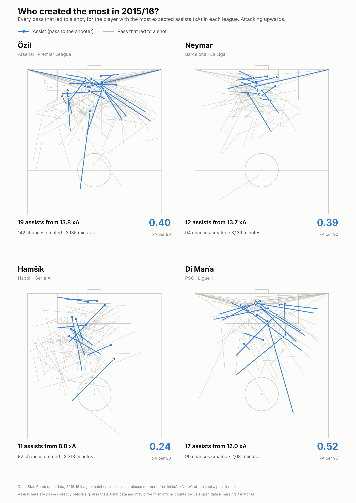
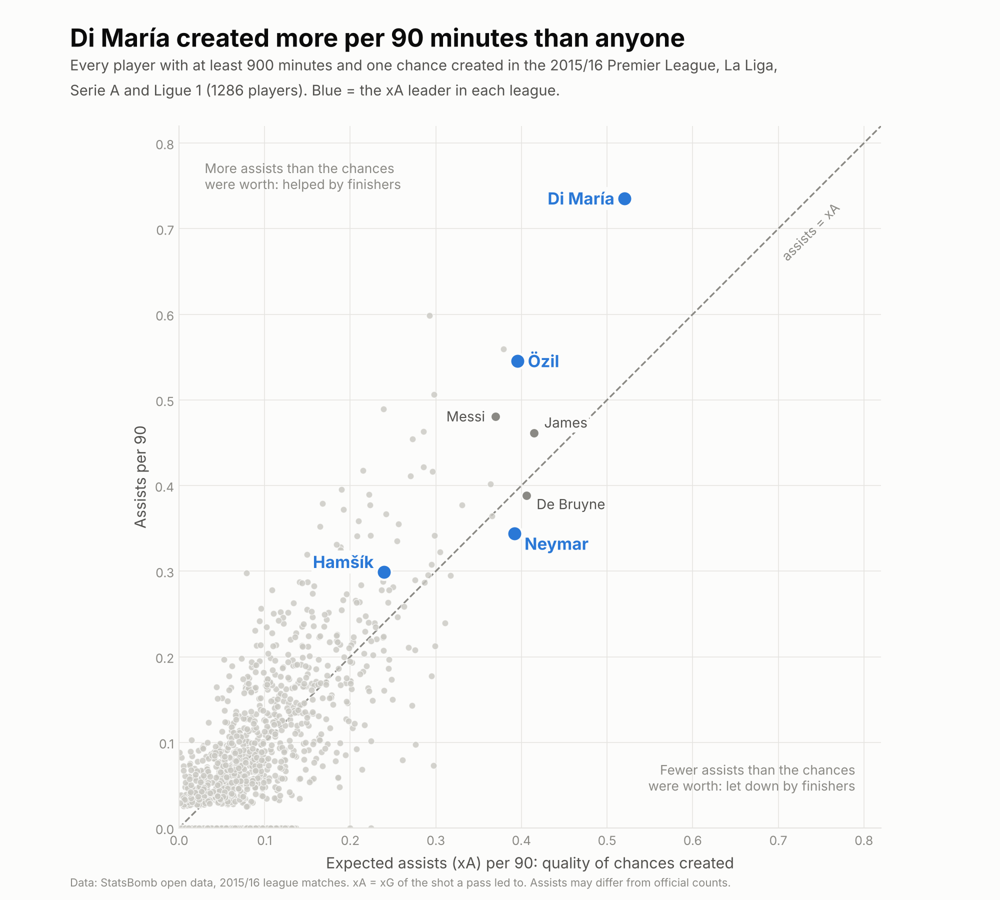

# Who created the most in 2015/16?

A look at chance creation in Europe's top four leagues in 2015/16, using StatsBomb open event data. It focuses on the player with the most expected assists (xA) in each league:

| League | Creator | Assists | Chances created | xA |
|---|---|---|---|---|
| Premier League | Mesut Özil (Arsenal) | 19 | 142 | 13.8 |
| La Liga | Neymar (Barcelona) | 12 | 94 | 13.7 |
| Serie A | Marek Hamšík (Napoli) | 11 | 92 | 8.8 |
| Ligue 1 | Ángel Di María (PSG) | 17 | 90 | 12.0 |

The project asks two questions:

1. How did each league's top creator make his chances?
2. Who created the most per 90 minutes, and how much did finishers affect each creator's assists?

## Key findings

**1. Four different ways to create.** Özil created the most chances (142), and about a third of his xA came from set pieces. Neymar's chances came from close range, inside and around the box, giving him the highest open-play xA of anyone (12.8). Hamšík created from deeper, mostly the left half-space. Many of Di María's assists were diagonal passes from the right into the box.



**2. Di María created more per 90 minutes than anyone.** Among the 1,286 players with at least 900 minutes and one chance created, Di María ranked 1st for both xA per 90 (0.52) and assists per 90 (0.74). Season totals hide this because he played fewer minutes (2,081) than the other three.

**3. Assists depend on the finisher; xA does not.** Özil (+5.2) and Di María (+5.0) had more assists than their chances were worth. Neymar had 1.7 fewer: he ranked 5th for xA per 90 but 28th for assists per 90.



| Per 90 minutes | xA | Assists | xA rank | Assists rank |
|---|---|---|---|---|
| Di María | 0.52 | 0.74 | 1st | 1st |
| Özil | 0.40 | 0.55 | 4th | 4th |
| Neymar | 0.39 | 0.34 | 5th | 28th |
| Messi (for context) | 0.37 | 0.48 | 7th | 7th |
| Hamšík | 0.24 | 0.30 | 46th | 40th |

## Definitions

- **Key pass / chance created:** a pass immediately followed by a shot from the receiver, linked through StatsBomb's `key_pass_id` on the shot.
- **Assist:** a key pass whose shot was scored. This is StatsBomb's event-based definition and may differ from official assist counts, which use their own rules for deflections and similar cases.
- **Expected assists (xA):** the xG of the shot a pass led to, so it measures the quality of the chance created, whatever the shooter did with it. Penalties have no key pass and are never counted.
- **Set pieces:** passes from corners, free kicks, throw-ins, kick-offs and goal kicks. Open-play figures exclude them.
- **Minutes played:** worked out from each match's events. Starters play from kick-off, substitutes from the minute they come on, and a player stops when substituted or sent off. Match length is the time of the last event, so stoppage time counts.
- **Per 90:** totals divided by minutes, times 90. Only players with at least 900 minutes are included in per-90 comparisons.
- **League leaders** are chosen by total xA. Serie A was close: Hamšík 8.82, Insigne 8.74.

## Limitations

- One season, from 2015/16.
- The Ligue 1 open data is missing 3 matches, so Di María's and other Ligue 1 totals may be slightly lower than full-season figures. His per-90 figures use the minutes in the available matches.
- xA only counts passes that led to a shot. A brilliant pass that a teammate failed to shoot from earns nothing.
- Assists above or below xA in one season mostly reflect the finishers, and partly chance. They are not a stable measure of the creator.

## How to run

Requires Python 3.10 or later.

```bash
pip install -r requirements.txt

python part1_extract_key_passes.py      # every key pass from 1,517 matches (several minutes)
python part2_minutes_per90.py           # minutes for every player (several minutes)
python part3_chance_maps.py
python part4_xa_vs_assists_baseline.py
```

Run the scripts from the repository folder, in this order. Each script prints its numbers before saving its chart. Tables are saved to `results/` and charts to `figures/`.

Charts use the Inter font if it is installed and fall back to the default font otherwise.

## Data

Data: [StatsBomb open data](https://github.com/statsbomb/open-data). Please credit StatsBomb as the data source in any work that uses it.

## Related projects

- [How did the 2015/16 champions win their leagues?](https://github.com/rafizrayhan/statsbomb-champions-2015-16)
- [Same Golden Boot, different routes? The 2015/16 top scorers](https://github.com/rafizrayhan/statsbomb-top-scorers-2015-16)
